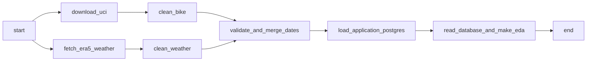
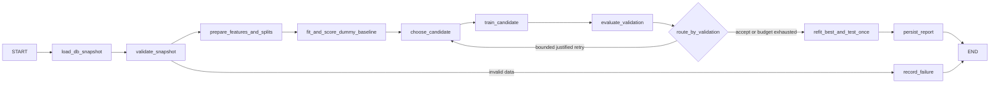

> Historical Phase A design retained for context. Parts 1 and 2 are now implemented and runtime-verified; [the root README](../README.md) and [Phase C status](verification/phase-c/status.md) document the actual system. The implemented ML policy has a hard cap of two candidates, default minimum two, Ridge alpha=10 then adaptive alpha=100 or a single-thread RandomForest; this supersedes the three-attempt candidate plan below. Current shared state is MLState in src/bike_demand_ml/state.py. The former placeholders are implemented. See the actual compiled graph and run evidence rather than treating this plan as a runtime report.
# Phase A design — not an implemented pipeline

The assignment files were read completely. Parts 1 and 2 remain pending. This design
was authored for DC bike demand and has no copied classroom DAG or agent loop.
No classroom code or UI was fetched. The optional bonus is outside this phase.

## Container topology and version contract

Use Docker Desktop's Linux engine with WSL2. The original Compose topology uses
Airflow **3.4.0 / Python 3.11**, a **LocalExecutor**, an API server, scheduler and
separate DAG processor. Two task subprocesses can ingest independently; set global
parallelism and per-DAG active tasks to 2, one active run, one API worker and one
DAG parsing process. Numeric-library thread counts are capped at one per task. Redis, Celery workers and a triggerer are
unnecessary for this small DAG, which will not use deferrable operators.

The official [3.4.0 Docker guide](https://airflow.apache.org/docs/apache-airflow/3.4.0/howto/docker-compose/index.html)
and its versioned Compose reference were read. Our configuration deliberately
changes its Celery layout to LocalExecutor, disables example DAGs, binds the UI
to loopback, and supplies an independent application PostgreSQL service. Airflow 3
uses `api-server`, `dag-processor`, `airflow.sdk` and the execution API URL; do not
substitute Airflow 2 `webserver` commands or legacy imports. The API JWT secret is
shared by Airflow processes; the Fernet key is separately generated. FAB provides
the local admin login. The official entrypoint sets the runtime umask, but its
DB wait does not cover a direct Python command. Our explicit init script performs
a bounded DB readiness check, migrates/checks metadata, and creates the admin only
when absent. It verifies the Admin role and fails on errors without resetting an
existing account or granting privileges to an existing non-admin. A separate persistent API
secret is shared across Airflow processes, independently of the JWT and Fernet keys.

| Component | Pin / source |
| --- | --- |
| Airflow base | `apache/airflow:3.4.0-python3.11` |
| Airflow providers | standard 1.21.0; postgres 7.1.1; FAB 3.10.2 |
| Airflow data packages | pandas 3.1.0; NumPy 2.4.6; SQLAlchemy 2.0.55; psycopg 3.3.6 |
| Both DB services | `postgres:16.11-bookworm`, separate instances/users/volumes |
| ML runtime | `python:3.11.14-slim-bookworm` |
| LangGraph | 1.0.3 |
| ML / dashboard | sklearn 1.7.2; pandas 2.3.3; NumPy 2.2.6; Streamlit 1.50.0; Plotly 6.3.1 |
| Static plots | matplotlib 3.10.7 |

All direct Python dependencies are pinned in `requirements/`. Airflow's downloaded
official Python 3.11 constraint snapshot is vendored with a checksum in verification
evidence. ML is isolated because dashboard and Airflow dependencies need not share
the same pandas version. Direct ML pins are not a complete transitive hash lock;
capture the actual Linux `pip freeze` after the first successful build. Docker tags
pin releases, not immutable image digests. Manifest/metadata checks and resolver
checks are recorded separately from a successful image build or runtime test.
No host Python installation is needed to run the eventual stack.

`airflow-db` stores only orchestration metadata; `app-db` stores assignment data.
No database ports are published. UI ports 8080 and 8501 bind to 127.0.0.1. Secrets
come from ignored `.env`; no API key is required for the educational weather API.
For a local course project the application role is also the DB bootstrap owner;
finer read/write roles can be added later without reusing the metadata role.

Named Linux volumes hold DB files, shared intermediate data, Airflow logs and
artifacts. This avoids NTFS bind-mount ownership/performance problems. Source and
DAG directories are read-only bind mounts from the Windows project. A one-shot
storage initializer changes ownership/mode of **only the three volume roots**,
giving group 0 write access. Airflow runs as UID 50000/group 0; the ML runner as
UID 10001/group 0. The dashboard reads artifacts through a read-only mount. The ML
runner uses umask 0002 so setgid volume directories and newly created descendants
retain group write without world write. It writes artifacts/events; its Phase A
placeholder still exits with a clear message. Existing inaccessible descendants
are not recursively chmod/chowned; any such issue requires a targeted runtime review.

Prefer >=8 GiB engine RAM and at least 20 GiB free on Docker's virtual disk host
drive before building both images. This is a project resource recommendation;
the official guide's minimum is 4 GB, ideally 8 GB. Current measurements and
limitations are in `verification/environment.md`. Start the ML profile only when
needed. No Docker resource settings are changed in Phase A.

## Source contracts and dates

Actual URLs, HTTP outcomes, checksums, measured schema, types, units and coverage
are in `verification/sources.json` and `verification/sources.md`. Verification
downloads are ignored raw evidence, not a completed assignment pipeline.

UCI `day.csv` stores local calendar date labels without timestamp/offset metadata.
Interpret these as DC rental-day labels per the research context; do not invent a
timezone field in the CSV. Open-Meteo is a reanalysis grid point, not a station
at the bike docks. Record requested and returned coordinates/elevation. Request
`models=era5` explicitly for a consistent historical model.

Weather daily `time` values are ISO date strings. The response returns
`timezone=America/New_York` with a fixed offset; current official documentation
states that daily aggregations use fixed 24-hour windows and do not follow DST
transitions within a long range. Preserve the returned labels and disclose the
boundary limitation. Do not convert midnight timestamps to UTC and then truncate.
If exact civil-day DST alignment becomes necessary, fetch hourly Unix timestamps,
convert through `zoneinfo`, and aggregate 23/25-hour days as a separately verified
method. That extension is outside Phase A.

## Daily Airflow DAG to implement in Phase B

Proposed ID: `dc_bike_weather_daily`. Use `schedule="0 6 * * *"` with an aware
`pendulum.datetime(2026, 11, 1, tz="America/New_York")`, `catchup=False`,
`max_active_runs=1`, `max_active_tasks=2`, DAG timeout 30 minutes. The scheduler
reruns a historical reproducibility/refresh exercise at 06:00 DC local time;
it does not imply that new 2011–2012 observations appear daily. Keep the DAG paused
until Phase B implementation and validation finish. The first scheduler run follows
Airflow's completed interval semantics; a manual run can verify it sooner.

There is no dependency between either ingestion/cleaning branch. Each gets
two retries, 60-second exponential delay capped at 5 minutes, a request timeout
and explicit HTTP status validation. Honor 429 `Retry-After`, cap its wait, and
retry only transient 429/5xx/network failures; fail permanent schema/4xx errors.
Airflow retries must not multiply an unbounded HTTP retry loop.

Write raw and cleaned branch artifacts under a path derived from a sanitized/hash
run ID in `project-data`, retaining URL, request parameters, response checksum,
fetch timestamp and schema version. XCom carries paths/small validation summaries,
not DataFrames or full JSON. A retry writes atomically to its own run directory.
An optional checksum cache must retain source provenance and declare cache hits.
The Phase B DAG must itself download the UCI ZIP and call the Open-Meteo API in
its two ingestion tasks, storing responses in the named volume. Host verification
files are neither mounted nor copied into that volume and cannot substitute for
a successful pipeline download. Offline fixtures/cached reruns must be labeled.

`clean_bike`: verify 16 expected columns; strict date/int/float parsing; uniqueness,
full expected range, nonnegative counts, finite numeric values, category domains,
and `cnt=casual+registered`. Keep calendar features and target; retain excluded
columns only in raw evidence. Never silently drop a bad row.

`clean_weather`: validate metadata/units, exact array lengths, date order,
uniqueness, complete expected coverage, finite non-null numbers, nonnegative
precipitation/wind and min <= mean <= max. Preserve all five independent weather
features. Do not substitute UCI weather when the API fails.

`validate_and_merge_dates`: use an outer diagnostic join with `validate="one_to_one"`
and `_merge`; record both unmatched counts and fail if either is nonzero. Only
then create the final 731-row date-ordered dataset. Assertions apply to this fixed
assignment date range, not arbitrary future datasets.

`load_application_postgres`: apply a versioned migration in the **application** DB;
write in one transaction, with `date` as primary key and `ON CONFLICT(date) DO
UPDATE`. Record the input hashes, run ID, source metadata, row counts, dataset
hash and schema version; commit success only after database validation. Rerun
must retain exactly 731 unique dates. On failure roll back and leave the prior
committed snapshot available. No destructive table replacement is needed.

Proposed `bike_daily` schema:

| Columns | SQL type / rules |
| --- | --- |
| date | DATE PRIMARY KEY |
| cnt | INTEGER NOT NULL CHECK >= 0 |
| yr, mnth, weekday, season | SMALLINT NOT NULL with explicit domain checks |
| holiday, workingday | BOOLEAN NOT NULL, parsed from UCI 0/1 |
| temperature_2m_mean/max/min | DOUBLE PRECISION NOT NULL, Celsius |
| precipitation_sum | DOUBLE PRECISION NOT NULL CHECK >= 0, mm |
| wind_speed_10m_max | DOUBLE PRECISION NOT NULL CHECK >= 0, km/h |
| dataset_hash, pipeline_run_id | TEXT NOT NULL, provenance references |
| loaded_at | TIMESTAMPTZ NOT NULL, UTC audit timestamp |

Add `pipeline_runs` with source URLs/hashes, parameters, unmatched counts, status
and timestamps; enforce min/mean/max ordering. Persist source metadata as JSONB
without secrets. Add immutable dataset snapshots or a repeatable-read export for
model runs so a daily upsert cannot change a run's inputs halfway through training.

`read_database_and_make_eda`: open a new SQL connection after load; execute a
date-ordered SELECT, validate row count/hash, and produce weekday/month demand,
demand vs temperature and precipitation figures plus an observed-data summary.
No file-only shortcut or pre-load DataFrame reuse. Write under
`project-artifacts/eda/<run_id>/` with DB query and dataset hash in the manifest.
At Phase A design time no findings/plots existed. Current Part 1 findings and
real plots are documented in verification/phase-b/status.md.

## Original LangGraph workflow to implement in Phase C

This is a deterministic specialist workflow using LangGraph, not an LLM making
unverifiable training claims. The assignment does not mandate an LLM key; nodes
execute feature preparation, scikit-learn fitting and evaluation. The original
control policy uses validation error and a train/validation gap to choose the next
candidate. Instructor acceptance of deterministic agents can be checked separately;
no paid service or demo loop is assumed.

Implement `TypedDict BikeModelState` with `run_id`, immutable `dataset_hash`,
`snapshot_path`, `split_boundaries`, `feature_names`, `attempt` (initial 0),
`max_attempts` (3), `candidate_spec`, `tried_specs`, `baseline_metrics`,
`train_metrics`, `validation_metrics`, `best_spec`, `best_validation_rmse`,
`artifact_paths`, `stop_reason`, and append-only `events`. Never put credentials
in state or events. The agent load node must SELECT cleaned rows from application PostgreSQL
(`app-db`, database `bike_demand`) in a consistent snapshot, validate its persisted
dataset hash, and only then export an immutable run snapshot. It must not read
`data/raw`, pipeline intermediate files, or Airflow metadata as training input.

Use `StateGraph`, real nodes/edges and `add_conditional_edges`; compile and stream
the executable graph. No mocked graph animation counts as execution evidence.

Chronological boundaries are fixed before training: 2011 train (365 days),
2012-01-01 through 2012-06-30 validation (182), 2012-07-01 through 2012-12-31
test (184). No random split. Fit imputation, scaling and encoders on training
only. Use a scikit-learn Pipeline/ColumnTransformer; weather inputs come only from
Open-Meteo. Calendar fields include season, month, weekday, holiday, workingday
and year; a date-derived elapsed-day trend can be evaluated with a declared origin.
Exclude `casual`, `registered`, `instant`, UCI weather (`temp`, `atemp`, `hum`,
`windspeed`, `weathersit`) and any derived target totals. Year/trend extrapolation
and distribution drift are limitations to report, not justification to shuffle.

Baseline is `DummyRegressor(strategy="mean")`. Candidate attempt 1 is standardized
Ridge(alpha=10). Increment `attempt` once per candidate, including failed fits;
save candidate identity before fitting to prevent retrying it forever.

The router uses validation RMSE only for selection. If the current best improves
on baseline RMSE by >=5% (`best_rmse <= 0.95 * baseline_rmse`), stop and accept.
This is a predeclared stopping target, not a promised outcome. If there is remaining
budget and validation RMSE / max(train RMSE, epsilon) > 1.5, try stronger
regularization (Ridge alpha=100 then 1000, skipping used specs). Otherwise try a
small nonlinear model (RandomForest, 200 trees, depth=5, min_samples_leaf=10,
random_state=706, n_jobs=2), then HistGradientBoosting(max_iter=100,
max_leaf_nodes=7, l2_regularization=10, early_stopping=False, random_state=706).
Take the first unused applicable spec. Stop on exhausted budget or no unused
candidate. A failed candidate gets an event/reason and consumes a slot; invalid
input or DB failure aborts to `record_failure` rather than fitting around it.
Use a graph recursion limit of 40 as a second termination guard.

Track the best validation candidate across attempts. If no valid candidate beats
Dummy, honestly select Dummy. Freeze selection, refit it and the comparison Dummy
on train+validation, then evaluate each on untouched test **once**. A poor test
score must not trigger another tuning loop. Report MAE, RMSE and R², baseline
comparison, validation trial history, stopped reason and elapsed time. There are
no metrics in Phase A. Models explain/backtest historical daily counts using
observed weather; they do not provide operational future-demand forecasts.

Live dashboard: consume LangGraph `stream` events persisted as run-scoped JSONL
or DB event records by the runner. Derive the displayed graph from the compiled
workflow, highlight the current/completed node and conditional edge, and update
trial/MAE/RMSE tables as actual events arrive. Show errors/budget stops and data
hash. Use regression labels, no classification accuracy meter. The dashboard
placeholder explicitly says Phase A and shows no fabricated progress/results.
